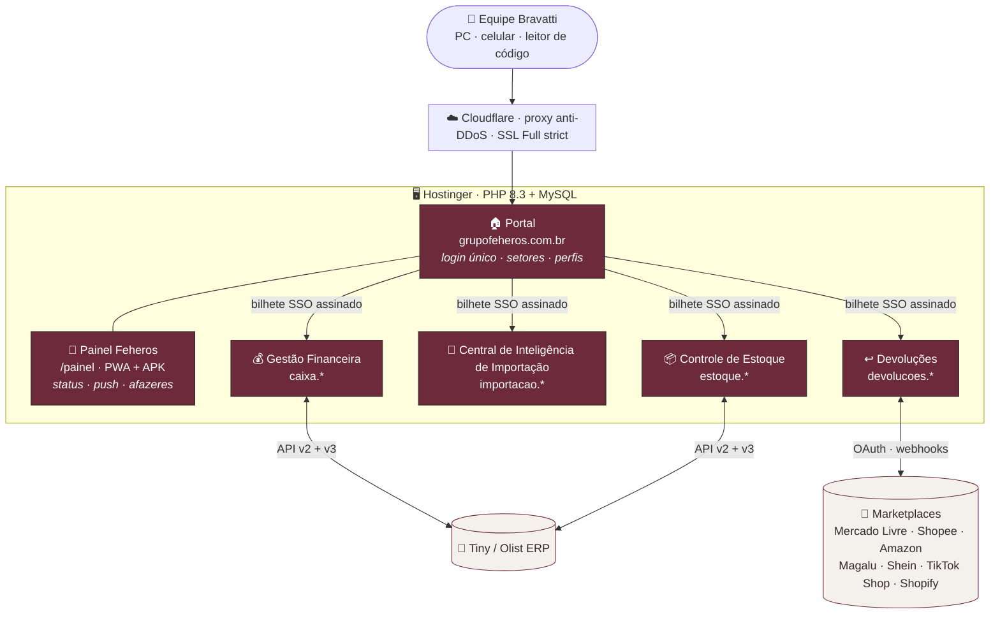
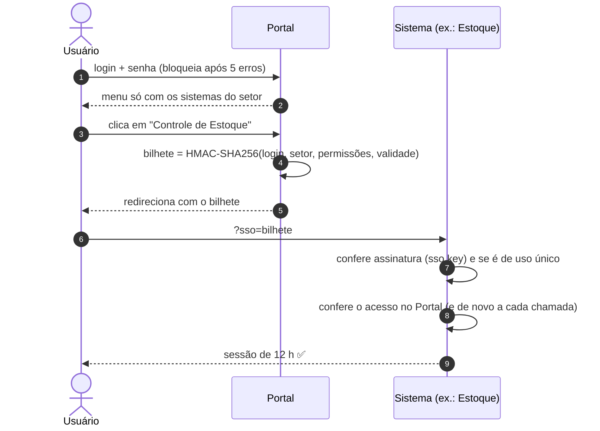
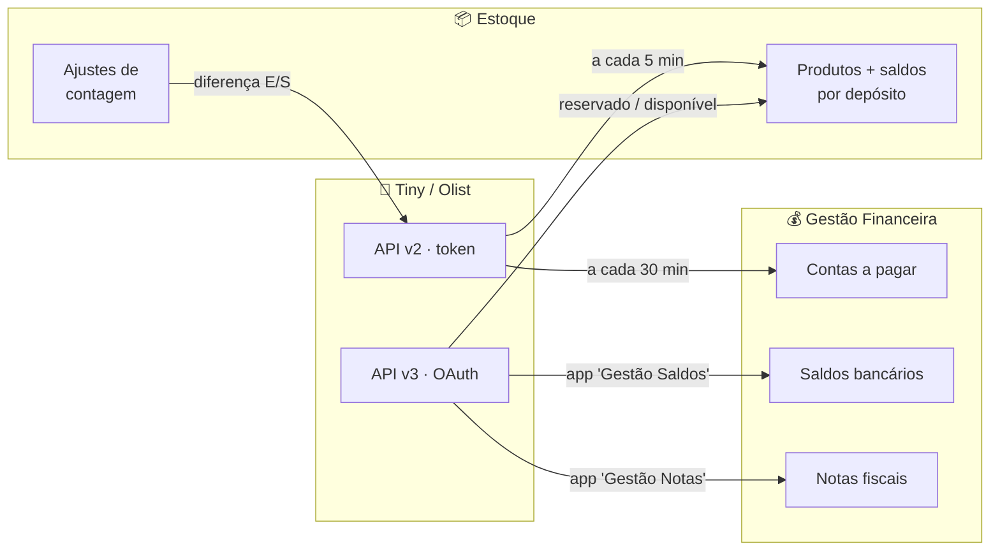
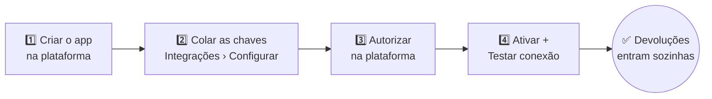
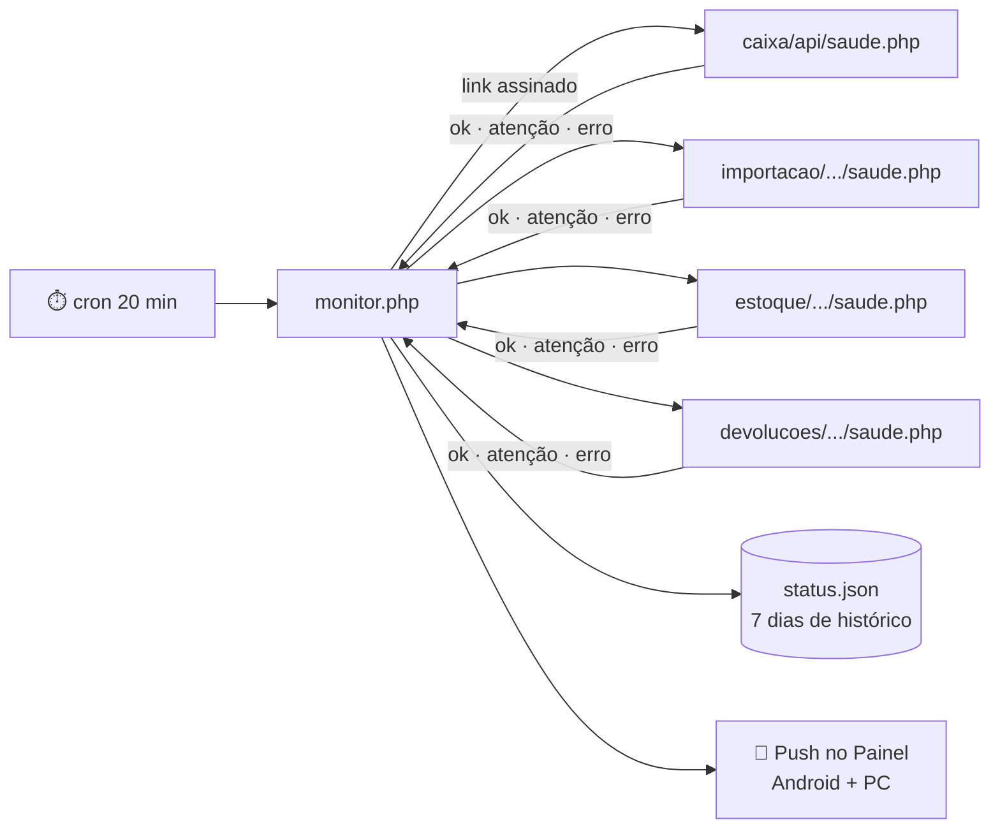
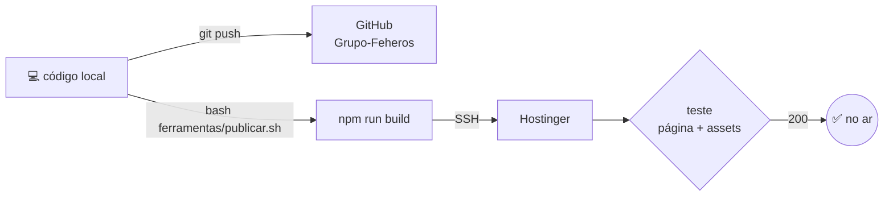

<div align="center">

# 🍷 Grupo Feheros · Bravatti

**Os sistemas internos da Bravatti: um portal, um login e cada setor com as suas ferramentas.**


</div>

---

## 🗺️ Visão geral



---

## 📚 Repositórios

| Sistema | Repositório | Endereço | O que faz |
|---|---|---|---|
| 🏠 **Portal** | [`Feheros-Portal`](https://github.com/Grupo-Feheros/Feheros-Portal) | grupofeheros.com.br | Porta de entrada: login, setores, permissões, perfis com foto, monitor e Painel |
| 💰 **Gestão Financeira** | [`Feheros-Caixa`](https://github.com/Grupo-Feheros/Feheros-Caixa) | caixa.grupofeheros.com.br | Fluxo de caixa, contas a pagar e receber, APR/DFC, projeções, empréstimos, folha |
| 🚢 **Central de Inteligência de Importação** | [`Feheros-Importacao`](https://github.com/Grupo-Feheros/Feheros-Importacao) | importacao.grupofeheros.com.br | Processos de importação: câmbio, FINIMP, impostos, custo real, payback e leitura de PDF |
| 📦 **Controle de Estoque** | [`Feheros-Estoque`](https://github.com/Grupo-Feheros/Feheros-Estoque) | estoque.grupofeheros.com.br | Contagens com leitor de código de barras, conferência, fechamento quinzenal, ajustes no Tiny |
| ↩️ **Devoluções** | [`Feheros-Devolucoes`](https://github.com/Grupo-Feheros/Feheros-Devolucoes) | devolucoes.grupofeheros.com.br | Devoluções, Full, mimos e transferências, com fotos, vídeos, disputas e arquivamento |
| 📊 **Gestão à Vista** | [`Feheros-Gestao-a-Vista`](https://github.com/Grupo-Feheros/Feheros-Gestao-a-Vista) | gestao-a-vista.grupofeheros.com.br | Vendas por canal, metas, projeção, produtos, clientes e indicadores (pedidos do Tiny) |
| ✅ **Cronos** | [`Feheros-Gestao-Interna`](https://github.com/Grupo-Feheros/Feheros-Gestao-Interna) | cronos.grupofeheros.com.br | Tarefas, projetos, OKRs, campanhas, calendários e diário de bordo |
| 🧭 **Atlas** | [`Feheros-Atlas`](https://github.com/Grupo-Feheros/Feheros-Atlas) | atlas.grupofeheros.com.br | Supply chain: estoque, reposição, ordens de compra e envios ao Full |
| 🪐 **Órbita** | [`Feheros-Orbita`](https://github.com/Grupo-Feheros/Feheros-Orbita) | orbita.grupofeheros.com.br | Análises a partir das planilhas da empresa |
| 🏆 **Liga Bravatti** | [`Feheros-Liga`](https://github.com/Grupo-Feheros/Feheros-Liga) | liga.grupofeheros.com.br | Programa de afiliados (vendas Yever) |
| 🎡 **Roleta** | [`Feheros-Roleta`](https://github.com/Grupo-Feheros/Feheros-Roleta) | roleta.grupofeheros.com.br | Roleta de prêmios para clientes (página pública + admin pelo portal) |
| 📘 **Bravatti Docs** | [`Feheros-Bravatti-Docs`](https://github.com/Grupo-Feheros/Feheros-Bravatti-Docs) | bravatti-docs.grupofeheros.com.br | Documentação interna da marca |
| 📡 **Monitor** | [`Monitor-Feheros`](https://github.com/Grupo-Feheros/Monitor-Feheros) | — | Ferramentas do monitoramento |

> ℹ️ **Central de Inteligência de Importação e Gestão Financeira usam o mesmo código.** O sistema escolhe o menu pelo endereço em que foi aberto, e cada commit vai para os dois repositórios.

---

## 🌳 Como cada sistema é organizado

Todos os sistemas seguem o mesmo esqueleto:

```text
Feheros-<Sistema>/
├── api/                      ← back-end PHP 8.3 (JSON)
│   ├── index.php             ← roteador: uma rota por ação  (?r=...)
│   ├── _base.php             ← banco, sessão, permissões, freio por IP
│   ├── _sso.php              ← entrada pelo Portal (login único)
│   ├── saude.php             ← "estou bem?" para o monitor (assinado)
│   ├── cron.php              ← tarefas automáticas (só linha de comando)
│   ├── rotas/                ← regras de cada módulo
│   └── integracoes/          ← conectores (Tiny, marketplaces…)
├── web/                      ← front-end React + TypeScript + Vite
│   └── src/paginas/          ← uma tela por arquivo
└── ferramentas/
    ├── publicar.sh           ← build + envio por SSH + teste
    └── servidor-dev.mjs      ← roda local (php-wasm + SQLite)

no servidor, FORA do site publicado:
privado/
├── config.php                ← senha do banco
├── sso.key                   ← chave do login único (igual em todos)
├── integracoes.key           ← chave que cifra os tokens das APIs
├── anexos/                   ← fotos, vídeos, PDFs
└── backups/                  ← backup diário do sistema
```

---

## 🔐 Login único (SSO)

A pessoa entra **uma vez** no Portal. Ao abrir um sistema, o Portal gera um bilhete assinado que vale **60 segundos** e **só pode ser usado uma vez**.



- **Setores:** Administrador, Devoluções, Gestão Financeira, Estoque, Importação e outros que o admin criar. Cada setor define o que se pode fazer em cada sistema.
- **O Portal é a central.** Usuários, acessos e permissões só existem lá: nenhum sistema tem tela de usuários nem login com senha. O acesso é conferido a cada chamada, então tirar alguém no Portal vale na hora, inclusive pelo link direto.
- **Fotos de perfil:** ficam no Portal e aparecem em todos os sistemas por um link assinado.

---

## 🔌 Integrações



### ↩️ Marketplaces → Devoluções

Os **7 conectores estão programados**. Para ligar um marketplace, basta colar as chaves do app:



| Plataforma | Autenticação | Busca | Aviso na hora |
|---|---|---|---|
| Mercado Livre | OAuth (botão Autorizar) | reclamações com devolução | ✅ tópico `claims` |
| Shopee | OAuth da loja + assinatura HMAC | `returns/get_return_list` | ✅ push assinado |
| TikTok Shop | OAuth da loja + assinatura HMAC | `returns/search` | ✅ webhook assinado |
| Magalu | OAuth (ID Magalu) | SAC › remessa reversa | ✅ webhook v1 assinado |
| Amazon | LWA (refresh token) | relatórios de devolução (próprio e FBA) | — (só periódica) |
| Shopify | token do app personalizado | GraphQL `orders → returns` | ✅ HMAC |
| Shein | autorização da loja + assinatura | lista de devoluções | — |

- **Redirect URI único:** `https://devolucoes.grupofeheros.com.br/api/autorizar.php`
- **Tokens:** são renovados sozinhos e guardados cifrados (AES-256-GCM).
- **Vínculo com registros manuais:** se a equipe já cadastrou a devolução, a integração vincula pelo número do pedido em vez de duplicar.
- **O que a integração nunca altera:** conferência, condição, destino, fotos do CD e observações. Isso é trabalho da equipe.

---

## ⏱️ Tarefas automáticas (cron da Hostinger)

| Quando | O quê |
|---|---|
| a cada **5 min** | Estoque: sincroniza produtos e saldos com o Tiny |
| a cada **10 min** | Painel: lembretes dos afazeres (seg a sex, 7h às 16h40) |
| a cada **20 min** | Monitor: verifica todos os sistemas e manda push para o Painel |
| a cada **30 min** | Gestão Financeira: Tiny (contas, saldos, notas) e backup do dia · Devoluções: integrações, arquivamento e backup do dia |
| a cada **1 min** | Gestão à Vista: executor de rotinas (pedidos do Tiny a cada 5 min, status, estoque, kits, marcas, análise) |
| a cada **30 min**, a partir das 04:00 | Atlas: sincroniza com o Tiny em etapas e gera o painel, até concluir a rodada do dia |
| **03:30** todo dia | Backup completo no servidor: banco + `privado/` de cada sistema |

---

## 📡 Monitoramento



O monitor avisa quando um sistema cai ou fica lento (API acima de 8 s, banco acima de 1,5 s), quando o cron atrasa, quando o backup atrasa e quando o certificado HTTPS está perto de vencer.

---

## 🚀 Publicação



- O `publicar.sh` envia `api/`, o build e o `.htaccess`. O `index.html` vai **por último**; depois o script apaga os assets antigos e testa o site.
- **Nunca** use o deploy por arquivo compactado da Hostinger: ele apaga a `public_html` inteira.
- Commits vão direto no `main`.

---

## 🎨 Padrão visual

| Elemento | Valor |
|---|---|
| Fontes | **Montserrat** no texto · **Faculty Glyphic** nos títulos |
| Vinho (menu, login, botões) | `#6c2a3b` |
| Creme (fundo) | `#f4f0ec` |
| Grafite (texto) | `#322b2b` |
| Status | 🟢 `#1f8a4c` · 🟡 `#a86b00` · 🔵 `#2563b0` · 🔴 `#c0392b` · 🟠 `#b8541a` |
| Cantos | 4 px nos cartões · 2 px em botões e campos |

---

## 🛡️ Segurança

- Cloudflare na frente de tudo, com SSL **Full (strict)**, HTTPS obrigatório e TLS 1.2 ou superior.
- Senhas, chaves e anexos ficam em `privado/`, **fora** da pasta pública. Os arquivos `_*.php` são bloqueados no `.htaccess`.
- Senhas guardadas como hash. Login com freio por IP e bloqueio por usuário.
- Credenciais das APIs cifradas. Webhooks conferidos por token na URL e pela assinatura da plataforma.
- Cabeçalhos HSTS e de segurança em todos os sites. Backup diário automático no servidor.

<div align="center"><sub>Grupo Feheros · Bravatti — sistemas internos</sub></div>
